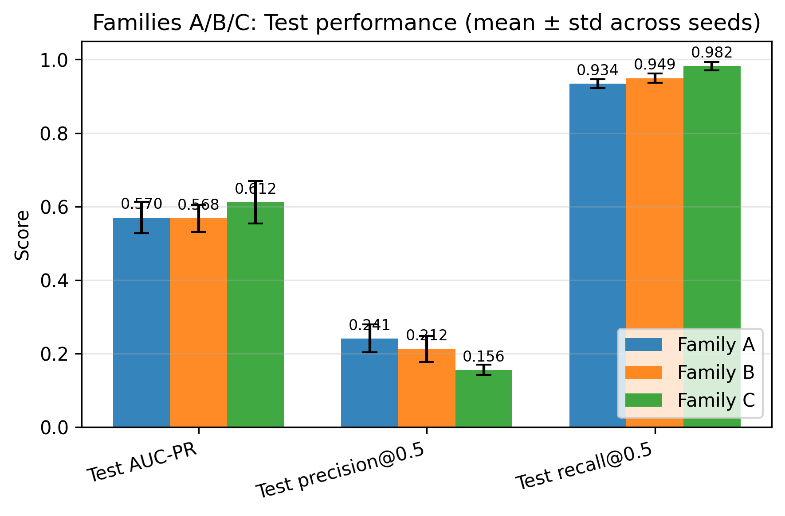

# Wildfire Spread Prediction with SAR

Predicting where a wildfire will spread the next day using a CNN trained on satellite
radar, weather, and terrain data.

For each fire, the pipeline builds a stack of daily inputs on a 500 m grid: fire
perimeters, GridMET weather, terrain, and Sentinel-1 SAR backscatter, stored as Zarr.
A U-Net style model then predicts which cells burn the next day. I compared a
baseline without radar against models with Sentinel-1 SAR, and also tried
fine-tuning on early NISAR L-band data.

Averaged over three seeds on California fires, the no-radar and Sentinel-1 models
landed at about the same AUC-PR (0.57), but the SAR model had higher recall and a
better validation score on every seed. Fine-tuning on NISAR reached 0.61 AUC-PR.
NISAR coverage is still limited, so treat that number as early.



## Setup

```bash
pip install -r requirements.txt
pip install -r requirements-training.txt
```

Data access needs a few keys, set in a `.env` file: `EARTHDATA_TOKEN`,
`OPENTOPOGRAPHY_API_KEY`, `EARTHENGINE_PROJECT`, and optionally `FIRMS_MAP_KEY`.

## Usage

Build datasets for a list of fires:

```bash
python -m src.pipeline.batch_process \
  --manifest-csv configs/nisar_global_fires.csv \
  --output-root processed/nisar_global
```

Train a model:

```bash
python -m src.training.train_cnn \
  --data-root processed/nisar_global \
  --fires-file configs/fires_nisar_training.txt \
  --family C \
  --out-dir experiments
```

See [docs/NISAR_DATA.md](docs/NISAR_DATA.md) for how NISAR scenes are found and
checked, and [docs/TRAINING.md](docs/TRAINING.md) for training options. Processed
data and experiment outputs aren't committed, but they can be regenerated with the
scripts above.
